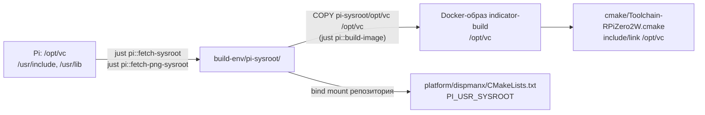

# Pi sysroot: что берётся с устройства и как используется при сборке

> Ветка `dev-pi2w` · Raspberry Pi Zero 2W · Raspbian Buster armhf · компилятор `zig cc` (`arm-zig-cc-a53`)

Полного sysroot (glibc, `/lib`, `/usr/lib`) в проекте **нет и не нужно**: `zig cc` сам
собирает crt-объекты и линкуется с собственной glibc нужной версии для
`arm-linux-gnueabihf`. С устройства копируются только две вещи, которых у zig нет.

| Что | Откуда (Pi) | Куда (хост) | Рецепт | Зачем |
|---|---|---|---|---|
| VideoCore SDK | `/opt/vc/` | `build-env/pi-sysroot/opt/vc/` | `just pi::fetch-sysroot` | `bcm_host.h`, DispmanX, VCOS, `libbcm_host.so`, `libvcos.so` |
| libpng + zlib | `/usr/include/{png,pngconf,pnglibconf,zlib,zconf}.h`, `/usr/lib/arm-linux-gnueabihf/{libpng16,libz}.so` | `build-env/pi-sysroot/usr/` | `just pi::fetch-png-sysroot` | загрузка PNG-спрайтов в `platform/dispmanx/layers/loadpng.c` |

`build-env/pi-sysroot/` в `.gitignore`: копируется один раз на машину разработчика.
`/opt/vc` и libpng16 в Buster armhf одинаковы для Zero W и Zero 2W (проверено в F1).

## Как это попадает в сборку



1. **`/opt/vc`** вкладывается в Docker-образ при `just pi::build-image`
   (`build-env/Dockerfile`: `COPY pi-sysroot/opt/vc /opt/vc`). Значит, после `fetch-sysroot`
   образ нужно пересобрать.
2. **Toolchain** (`cmake/Toolchain-RPiZero2W.cmake`):
   - компилятор `/usr/local/bin/arm-zig-cc-a53` = `zig cc -target arm-linux-gnueabihf -mcpu=cortex_a53`;
   - `CMAKE_C_FLAGS_INIT "-mfloat-abi=hard"` (без `-marm`: Thumb-2 + VFP на A53 поддерживается);
   - `include_directories(SYSTEM /opt/vc/include …)`, `link_directories(/opt/vc/lib)`;
   - `CMAKE_FIND_ROOT_PATH=/opt/vc`, `MODE_LIBRARY/INCLUDE ONLY`, `MODE_PROGRAM NEVER` —
     `find_*` не подхватит x86-библиотеки контейнера.
3. **libpng/zlib** подключаются в `platform/dispmanx/CMakeLists.txt` напрямую:
   `PI_USR_SYSROOT=${CMAKE_SOURCE_DIR}/build-env/pi-sysroot/usr`, include этого каталога
   и строки `-L… -lpng16 -lz` (обходят `CMAKE_FIND_ROOT_PATH_MODE_LIBRARY ONLY`).
   Если файлов нет, CMake останавливается с подсказкой `Run: just pi::fetch-png-sysroot`.

## Почему libpng — динамически

`libpng16.a` из Buster armhf собрана под `-march=armv7-a` (Thumb-2) и на Zero W (ARMv6)
падала в `.init_array` до `main()`. На Cortex-A53 этот код легален, но схема линковки
оставлена той же, что в ветке `dev-pi`, — до объединения веток в F6.

Итоговые зависимости `indicator` (проверка: `readelf -d build/pi/indicator | grep NEEDED`):
`libbcm_host.so`, `libpng16.so.16`, `libpthread.so.0`, `libc.so.6`. Все они есть
в штатном Buster Lite (`libpng16-16` ставит `setup_pi.sh`).

## Проверка результата сборки

```bash
readelf -A build/pi/indicator | grep -E "Tag_CPU_(name|arch)"   # "cortex-a53", v8
readelf -h build/pi/indicator | grep Flags                       # Version5 EABI, hard-float ABI
readelf -l build/pi/indicator | grep interpreter                 # /lib/ld-linux-armhf.so.3
```
